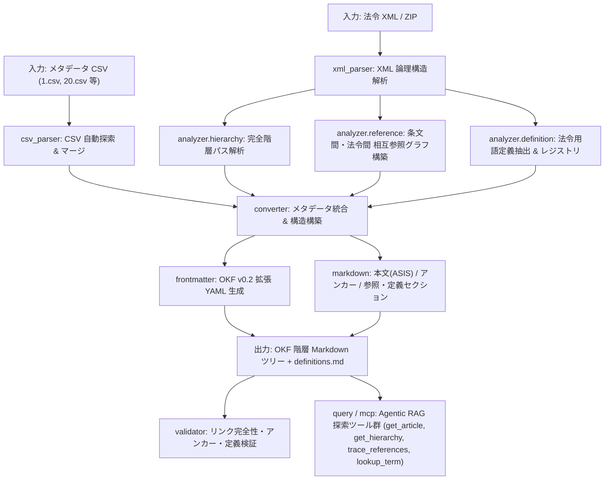

# 変換パイプライン アーキテクチャ

## 1. 概要

本システムのコアである `law2markdown` は、e-Gov 法令標準 XML スキーマ v3 に準拠した XML ファイル（および付随するメタデータ CSV）を入力とし、決定論的（Deterministic）かつ完全原本維持（ASIS）で OKF 準拠の Markdown ファイル群を出力するパイプラインを提供します。
さらに、Agentic RAG（自律的法探索基盤）に対応するため、完全階層パス・相互参照グラフ・親子アンカー・法令用語定義レジストリを決定論的に解析・生成し、エージェント用クエリおよび MCP サーバーインターフェースを包含します。

## 2. パイプライン構成

## 3. コンポーネント役割

| モジュール | 役割 |
|---|---|
| `law2markdown.parser.xml_parser` | 法令 XML をパースし、条文・項・号・表・数式・附則・様式を中間モデル（`ParsedLaw`）に抽出 |
| `law2markdown.parser.csv_parser` | ZIP 内の複数 CSV（連番 CSV 含む）を探索し、公布日・施行日・カナ等のメタデータを抽出 |
| `law2markdown.analyzer.hierarchy` | 編・章・節・款・目の階層スコープを厳密追跡し、`hierarchy_path` を構築 |
| `law2markdown.analyzer.reference` | 条文内の相対参照（前条・次条）・明示参照（第〇条）・委任規定を解析し、双方向グラフ（`outbound`/`inbound`）を構築 |
| `law2markdown.analyzer.definition` | 「〜とは、〜をいう」「以下〜という」等の定義規定から専門用語を抽出し、`definitions.md` を自動編成 |
| `law2markdown.renderer.frontmatter` | `hierarchy_path`, `outbound_references`, `inbound_references`, `defined_terms`, `child_anchors` を含む OKF v0.2 YAML を生成 |
| `law2markdown.renderer.markdown` | 本文（ASIS）・行頭アンカー・パイプ表/HTML表・LaTeX数式・末尾参照/定義セクション・インデックスを生成 |
| `law2markdown.converter` | 全体オーケストレーション、出力ディレクトリ命名・衝突回避、最上位 `index.md` および `definitions.md` の一括生成 |
| `law2markdown.validator` | 出力ファイル群の相対リンク完全性検証（リンク切れ404の自動検出）、アンカー検証、統計監査 |
| `law2markdown.query` | エージェント向け探索コア関数（`get_article`, `get_hierarchy`, `trace_references`, `lookup_term`）の実装 |
| `law2markdown.mcp_server` | Model Context Protocol (MCP) stdio JSON-RPC サーバー |
| `law2markdown.cli` | コマンドラインインターフェース（`law2md convert`, `convert-zip`, `query`, `mcp`） |

## 4. 関連概念

* [法令 XML から OKF Markdown への変換仕様](../domain/law_converter.md) - 詳細な変換・マッピング規約
* [Wiki用 Markdown 出力詳細仕様書](../domain/wiki_markdown_spec.md) - 出力ツリー構造・アンカー・Frontmatter規約
* [実行環境と CLI 仕様](../infrastructure/cli_and_env.md) - コマンドライン実行と環境定義
